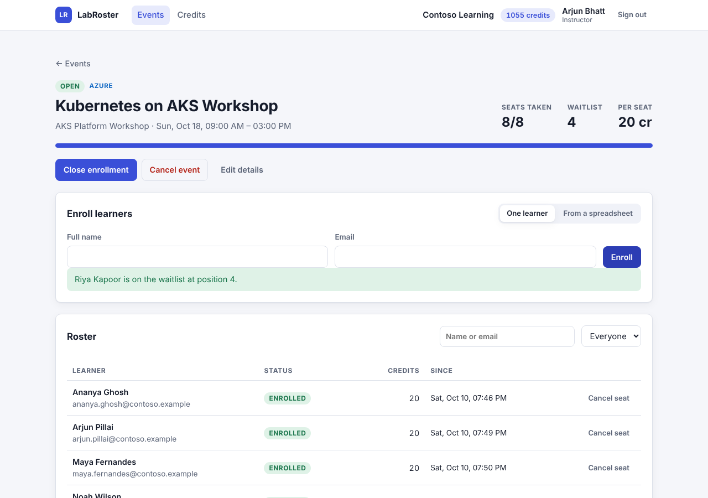
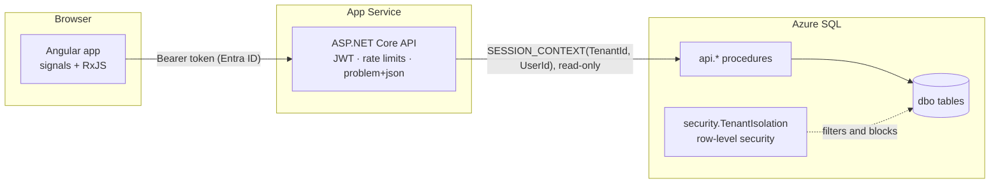

# LabRoster

[](https://github.com/shovand139-maker/labroster/actions/workflows/ci.yml)

Enrollment and seat management for instructor-led cloud lab events. Training organizations open an event for a lab template, enroll learners one at a time or from a spreadsheet, and pay for each seat from a prepaid credit balance. When an event is full, new learners join a waitlist that fills freed seats automatically.

**Stack:** ASP.NET Core 10 minimal APIs · SQL Server stored procedures with row-level security · Angular 21 with RxJS and signals · xUnit integration tests on a real SQL Server · Playwright · GitHub Actions · Bicep for Azure App Service and Azure SQL.



## What it does

- **Events** move through `draft → open → closed`, and can be cancelled from any of those states. Cancelling releases every seat and refunds every credit in one transaction.
- **Enrollment** takes a seat while seats and credits last, otherwise it joins the waitlist. Cancelling a seat refunds it and promotes the first waitlisted learner. Raising capacity promotes as many as fit.
- **Bulk enrollment** accepts a CSV export and reports an outcome for every row: enrolled, waitlisted, duplicate, already on the roster, invalid email or not enough credits.
- **Credits** are an append-only ledger with a cached balance that a `CHECK (Balance >= 0)` constraint protects.
- **Audit log**: every change is written by the procedure that made it, in the same transaction.
- **Roles** come from Entra app roles: Admin, Instructor and Viewer.

## How it is built



### Tenant isolation is enforced by the database

Every tenant-owned table has a `TenantId` column and a row-level security policy (`db/migrations/V002__security.sql`). Before running anything, the API sets `SESSION_CONTEXT('TenantId')` from the token's `tid` claim with `@read_only = 1`, so nothing later on that connection can switch tenant (`src/LabRoster.Api/Data/TenantConnectionFactory.cs`).

- **Filter predicates** hide other tenants' rows from every query, including ones inside procedures.
- **Block predicates** reject inserts and updates that would place a row in another tenant, even from `db_owner`.
- **The app login can only `EXECUTE` the `api` schema.** It cannot read a table directly or run the `admin` procedures. Integration tests check all three.

A bug that forgets a `WHERE TenantId = …` still cannot leak data across organizations.

### Seats are allocated without races

Each procedure that changes seats takes `UPDLOCK, HOLDLOCK` on the event row first and the tenant's credit row second. That fixed order serializes allocation per event and avoids deadlocks between these procedures. Credits are debited with a conditional update (`WHERE Balance >= @Cost`), so a seat is never taken without payment. An integration test fires 25 parallel enrollments at a five-seat event and checks for exactly 5 seats, 20 waitlist positions numbered 1 to 20, and 5 ledger rows.

### Safe writes over HTTP

- **Optimistic concurrency.** Events carry a `rowversion` exposed as a strong `ETag`. `PUT` and status changes require `If-Match`: a missing header gets `428`, and a stale one gets `412` without overwriting anyone's change.
- **Idempotency.** `POST /enrollments` accepts an `Idempotency-Key`. A retry with the same key returns the original enrollment with `Idempotent-Replay: true` and charges nothing. The Angular client reuses one key per click across its retries.
- **One error contract.** Procedures raise `THROW 50xxx, N'code|message'`, and the API maps 50400–50499 to the matching HTTP status as RFC 9457 problem details with a stable `code`. Validation errors list every field at once.

## API

| Method | Path | Who | Notes |
|---|---|---|---|
| GET | `/api/me` | Everyone | User, organization, role and credit balance |
| GET | `/api/events` | Everyone | `search`, `status`, `page`, `pageSize` |
| POST | `/api/events` | Admin, Instructor | Creates a draft. `201` with `Location` and `ETag` |
| GET | `/api/events/{id}` | Everyone | `ETag` header |
| PUT | `/api/events/{id}` | Admin, Instructor | `If-Match` required |
| POST | `/api/events/{id}/status` | Admin, Instructor | `open`, `closed` or `cancelled`. `If-Match` required |
| GET | `/api/events/{id}/roster` | Everyone | Enrolled first, then the waitlist in order |
| POST | `/api/events/{id}/enrollments` | Admin, Instructor | `Idempotency-Key`, rate limited per user |
| POST | `/api/events/{id}/enrollments/bulk` | Admin, Instructor | JSON or `text/csv`, up to 500 rows, one transaction |
| POST | `/api/enrollments/{id}/cancel` | Admin, Instructor | Refunds and promotes from the waitlist |
| GET | `/api/templates` · `/api/tenant/credits` | Everyone | |
| GET | `/api/audit` | Admin | |
| GET | `/health/live` · `/health/ready` | Public | Ready checks the database |

In Development the OpenAPI document is at `/openapi/v1.json`.

## Run it locally

You need the .NET 10 SDK, Node 24 and Docker.

```bash
docker compose up -d                       # SQL Server on localhost:1433

dotnet run --project src/LabRoster.Migrator -- \
  --connection "Server=localhost,1433;Database=LabRoster;User ID=sa;Password=LabRoster!Local2026;TrustServerCertificate=True" \
  --create-database --seed --app-login labroster_app --app-password 'Dev!App-Passw0rd'

dotnet run --project src/LabRoster.Api     # http://localhost:5080

cd web && npm ci && npm start              # http://localhost:4200, proxies /api to the API
```

Sign in with one of the demo accounts. Contoso Learning has an admin, an instructor and a viewer; Fabrikam Academy is a second organization whose data Contoso never sees.

## Tests

```bash
# Unit tests run anywhere; integration tests run when LABROSTER_TEST_SQL is set.
export LABROSTER_TEST_SQL="Server=localhost,1433;User ID=sa;Password=LabRoster!Local2026;TrustServerCertificate=True"
dotnet test LabRoster.slnx

cd web
npm test                                   # Vitest
npx playwright install chromium
E2E_BASE_URL=http://localhost:5080 npx playwright test
```

| Suite | Covers |
|---|---|
| `tests/…/Unit` | SQL error mapping, ETags, CSV parsing, request validation, token claims and signatures, Entra issuer checks, migration script rules |
| `tests/…/Integration` | Tenant isolation through the API and directly in SQL, pooled-connection context reset, parallel enrollment, idempotent retries, waitlist promotion, credits, ETag conflicts, roles, least-privilege login, idempotent migrations |
| `web/src/**/*.spec.ts` | Auth interceptor, If-Match and Idempotency-Key headers, debounced search, retries that reuse the same key, form validation |
| `web/e2e` | Tenant isolation in the UI, waitlist and promotion, creating and opening an event, API validation errors, read-only viewers, stale edits |

Integration tests share one throwaway database, built by the real migrator with a real least-privilege login. Each test provisions its own organizations, so tests never see each other's data and can run in any order.

## Delivery

- **CI** (`.github/workflows/ci.yml`) runs on every push and pull request: build with warnings as errors, unit and integration tests against a SQL Server 2022 service container, Angular tests and production build, then Playwright against the published API serving the built app.
- **Deploy** (`.github/workflows/deploy.yml`) is run by hand for QA or production. It signs in to Azure with OpenID Connect, applies `infra/main.bicep`, migrates the database with an Entra token, deploys, and smoke-tests `/health/ready`. Production waits for the environment's required reviewers.
- **Infrastructure** (`infra/main.bicep`): App Service on Linux, Azure SQL with Entra-only authentication, a system-assigned managed identity for the app, and Application Insights with Log Analytics. No passwords or connection secrets exist in any environment.
- **Operations**: `docs/runbook.md` covers rollback, alerts and the queries for the common incidents.

## Repository layout

```
db/
  migrations/      V###__*.sql, applied once in order, never edited
  procedures/      R__*.sql, CREATE OR ALTER, re-applied when changed
  seed/            demo data for development and end-to-end tests
src/
  LabRoster.Api/       endpoints, auth, tenant-scoped data access, problem mapping
  LabRoster.Migrator/  embeds the SQL and applies it; also used by the tests
tests/LabRoster.Api.Tests/
web/               Angular app, Vitest specs, Playwright end-to-end tests
infra/             Bicep
docs/              specs, runbook
```

## Author

Shovan Dutta · [github.com/shovand139-maker](https://github.com/shovand139-maker)
